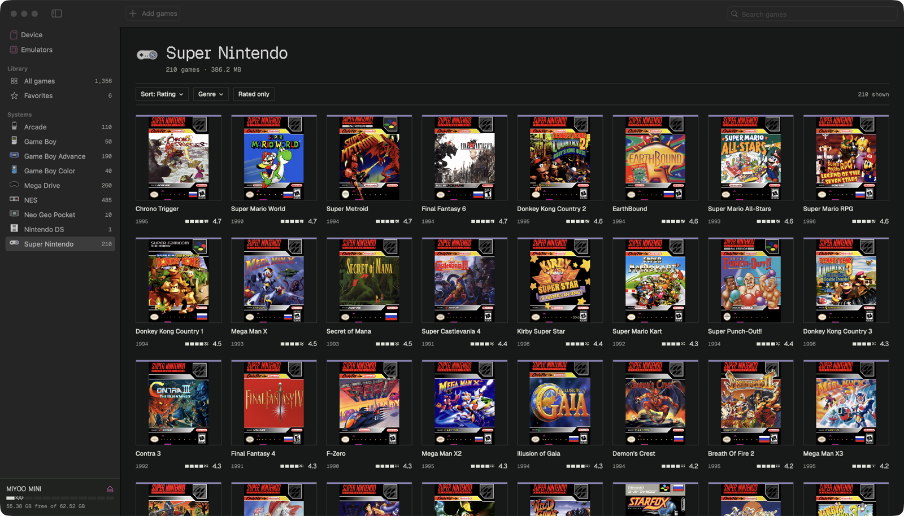
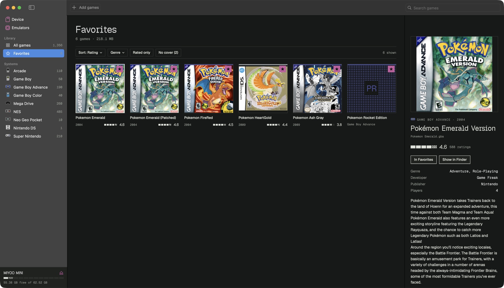
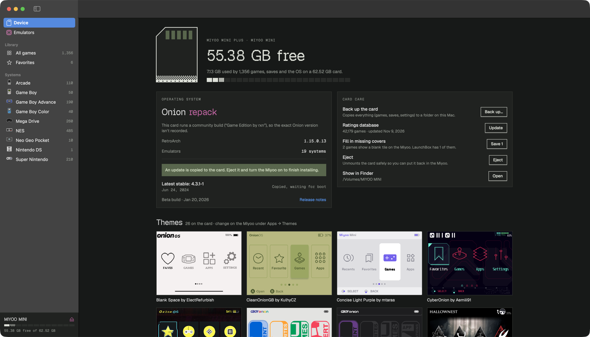
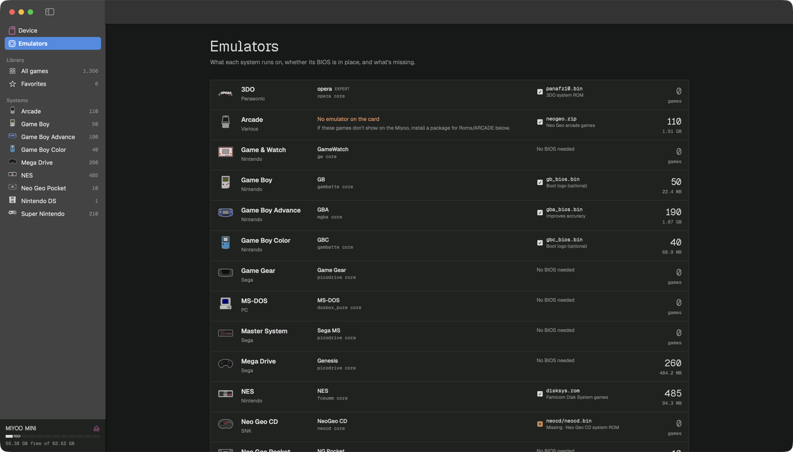

# Cartridge

**Manage your Miyoo Mini's SD card from your Mac.**

Cartridge is a native macOS app for Miyoo Mini and Mini Plus handhelds running [Onion OS](https://github.com/OnionUI/Onion). Put the microSD card in your Mac and Cartridge reads it directly. You can browse your games with box art and community ratings, fill in missing covers, set favorites, check which emulators and BIOS files are on the card, and keep Onion up to date.



## What it does

### Library
Every game on the card, with box art and details from the [LaunchBox Games Database](https://gamesdb.launchbox-app.com).

- **Browse** all games, your favorites, or one system at a time from the sidebar.
- **Sort** by rating, title, year, size or date added. Rating sort weights games by how many people rated them, so one 5-star vote doesn't top the list.
- **Filter** by genre, by games that have a rating, or by games with **No cover**. When "No cover" is on, a banner says how many covers LaunchBox has and saves them to the card in one click.
- **Favorite** a game and it appears in the Favorites tab on the Miyoo.
- **Add games** by dragging ROM files onto the window, or onto a system in the sidebar. Each file goes in the right folder based on its extension.
- **Delete** a game and its box art from the card.



### Device
- Free space at a glance, plus your Onion and RetroArch versions.
- The latest Onion release from GitHub. **Copy update to card** puts it on the card; the Miyoo installs it the next time it starts.
- **Back up** the whole card to a folder on your Mac.
- **Fill in missing covers** across the whole card.
- **Eject** the card safely, and preview the themes installed on it.



### Emulators
- Every system, the emulator and core it runs on, and how many games you have for it.
- **BIOS check:** shows which BIOS files are present, missing or optional for each system.
- **Install or remove emulators** from the 130+ packages Onion's Package Manager already keeps on the card. No downloads needed.



## Install

Requires macOS 15 or later and Xcode 16 or later (Swift 6).

```bash
git clone https://github.com/ste-bot/cartridge
cd cartridge
scripts/bundle.sh                     # builds dist/Cartridge.app
cp -R dist/Cartridge.app /Applications/
open /Applications/Cartridge.app
```

The app icon is generated by `scripts/make_icon.py` and needs Python 3 with Pillow (`pip install pillow`). Without it the app builds with the default icon.

The build is signed ad hoc for your own Mac. If you share the `.app` with someone else, macOS will ask them to confirm opening it (right-click → Open the first time).

## Using it

1. **Insert the card.** Cartridge finds any mounted volume with Onion's folders (`Roms/` plus `.tmp_update/` or `miyoo/`), and updates when you plug in or eject a card.
2. **Get ratings.** The first time, open **Device → Ratings database → Download**. It's a one-time download of about 110 MB, and everything works offline after that.
3. **Browse and tidy up.** Favorite what you play, delete what you don't, and turn on **No cover** to fill in missing box art.
4. **Eject** from the sidebar (⏏) or the Device page before taking the card out.

### Tips
- After adding or deleting games, Cartridge clears that system's list cache on the card, so the Miyoo rescans it the next time you open the system.
- Fan hacks and renamed ROMs often won't match a LaunchBox entry. They still work; they just show a dithered placeholder instead of art and ratings.
- If a system shows **No emulator on the card**, install one from the **Add or remove** list on the Emulators page.

## Data and privacy

| What | Where it comes from | Where it's stored |
|---|---|---|
| Ratings, genres, descriptions | LaunchBox public `Metadata.zip` | `~/Library/Application Support/Cartridge/` (an index of about 42k retro games) |
| Covers | `images.launchbox-app.com`, fetched when shown | `~/Library/Caches/Cartridge/covers`, or the card's `Imgs/` folders when you save them |
| Onion releases | GitHub API | Not stored |

Nothing about your library is uploaded anywhere. Cartridge doesn't include or download any games.

## How it reads the card

| Location on the card | What Cartridge does with it |
|---|---|
| `Emu/*/config.json`, `RApp/*/config.json` | Emulators, their ROM folders, file extensions and cores |
| `Roms/<SYSTEM>/` | Games; `Imgs/<name>.png` is the box art the Miyoo shows |
| `Roms/<SYSTEM>/*_cache6.db` | Onion's list cache, removed after changes so the device rescans |
| `Roms/favourite.json` | Favorites, one JSON object per line |
| `BIOS/` | BIOS checks; FinalBurn Neo `.dat` files give arcade games their real titles |
| `App/PackageManager/data/` | Emulator packages that can be installed or removed |
| `Icons/Default/` | Hardware icons for each system |
| `.tmp_update/onionVersion/version.txt` | Installed Onion version |

## Development

```bash
swift build && swift run
```

These launch arguments open a specific screen, which is handy for screenshots:

```bash
open dist/Cartridge.app --args -pane device        # or emulators, favorites, system:GBA
open dist/Cartridge.app --args -select "GBA/Game.gba" -nocover YES
```

The code lives in `Sources/Cartridge`:
- `Model/`: reading and writing the card (`Card.swift`), the LaunchBox index and title matching (`Ratings.swift`), Onion updates and backup (`Services.swift`), and app state (`AppModel.swift`)
- `UI/`: the design system (`Theme.swift`) and one file per screen

## Design

- **Palette:** taken from handheld hardware. The background is console plastic grey and the text is label ink. Panels use the olive of an unlit LCD. The one accent is the magenta-maroon of the A/B buttons.
- **Fills:** everything filled (storage, rating meters, placeholder art) is a 4×4 Bayer dither on a hard pixel grid, never a gradient.
- **Type:** [Geist Pixel](https://vercel.com/font) is for titles and numbers only. Body text is Geist and data is Geist Mono.

## Not affiliated

Cartridge is an independent project. It isn't affiliated with Miyoo, the Onion team, or LaunchBox. Game metadata, box art and system icons belong to their respective owners. Screenshots show the author's own card.

## License

[MIT](LICENSE) for the code. The bundled Geist fonts are under the SIL Open Font License 1.1 (`Resources/Fonts/OFL-Geist.txt`).
